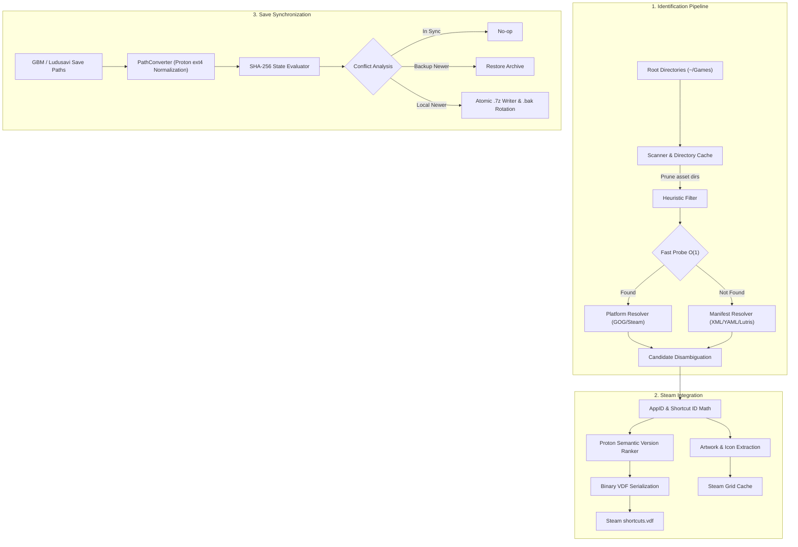

# Technical Architecture Specification

This document provides a detailed technical reference for the architecture, data structures, algorithms, and subsystem interactions of **NoSteam2Steam**.

---

## 1. System Overview

NoSteam2Steam automates three interconnected domains within Linux and SteamOS gaming environments:
1. Discovery and heuristic identification of non-Steam game installations.
2. Registration, asset fetching, and compatibility layer assignment in the Steam client.
3. Save file synchronization and archiving adhering to the Game Backup Monitor (GBM) specification.



---

## 2. Identification Subsystem

### 2.1 The Filesystem Traversal Problem

On Linux file systems (notably *ext4* on SteamOS internal NVMe drives and *ext4/exFAT/btrfs* on MicroSD cards), naive recursive directory traversal poses severe performance limitations. Modern game engines (e.g., Unity, Unreal Engine) distribute thousands of static asset files across deep hierarchies. For example, a standard game installation may contain over 13,000 files, with more than 99.8% located within `*_Data` or `Content/Paks` subdirectories.

Traversing these asset directories causes excessive random inode lookups, which on MicroSD storage with cold VFS caches can introduce 2 to 5 seconds of latency per game directory. Furthermore, Proton prefixes contain `.wine/dosdevices/z:` symlinks pointing to `/`, which can cause uncontrolled traversals into system root filesystems if symlinks and hidden directories are not strictly isolated.

### 2.2 Heuristic Tree Pruning

To maintain bounded $O(K)$ traversal cost (where $K$ represents the count of candidate binary nodes rather than total game assets), the scanner implements strict heuristic pruning in `nosteam2steam.identification.scanner`:

1. **Asset Directory Pruning:** Any directory whose lower-case name matches known asset containers is discarded immediately without inspecting its children:
   $$\text{Prune}(D) \iff D \in \{\text{content}, \text{paks}, \text{audio}, \text{sound}, \text{music}, \text{textures}, \text{shaders}, \text{dlc}, \dots\} \lor D \text{ ends with } \texttt{\_data}$$
2. **Hidden Directory and Symlink Isolation:** Hidden directories (names beginning with `.`) and symbolic links are excluded at the directory collection phase, preventing infinite loops or traversal of host filesystem trees via Wine prefix symlinks.
3. **Directory Tree Memoization:** The `DirectoryCache` stores evaluated trees per root folder, ensuring that subsequent matching passes (`PlatformResolver`, `CandidateResolver`) reuse existing in-memory directory structures rather than issuing redundant `os.walk` or `os.scandir` system calls.

### 2.3 Fast-Path Root Probing

Before executing deep manifest or catalog searches, the platform resolver performs constant-time $O(1)$ probes in the game root folder:
- **GOG Game Manifest:** Direct check for `goggame-*.info`. If present, title, game ID, and launcher executable are read directly from JSON.
- **Steam AppID File:** Direct check for `steam_appid.txt`. If present, the numerical AppID is mapped to existing Steam catalog data.
- **Auxiliary Manifests:** Files such as `.ini`, `.cfg`, and `.json` are evaluated up to a bounded maximum depth ($D \le 2$).

### 2.4 Stem Disambiguation for Generic Binary Names

Certain executable files share common generic binary names across distinct titles (e.g., `Game.exe`, `Launcher.exe`, `Main.exe`, `start.exe`). Matching such binaries strictly by filename against global databases (such as PCGamingWiki or Lutris catalogs) results in false positive collisions.

The candidate resolver enforces a disambiguation guard:
```python
if stem.lower() in GENERIC_EXECUTABLE_STEMS:
    score = simple_match_score(folder_name, candidate_name)
    if score < 50:
        # Reject candidate to avoid false-positive catalog misidentification
        continue
```
This guarantees that an executable named `Game.exe` inside a directory `/Games/Hades/` is not falsely classified as an unrelated historical title whose primary binary was also cataloged as `Game.exe`.

### 2.5 Binary Selection and Architecture Ranking

When multiple candidate executables exist within a game directory, the ranking algorithm selects the optimal target based on binary architecture and graphics API markers:
$$\text{Rank}(E) = w_{\text{arch}} + w_{\text{api}} - w_{\text{demote}}$$
- **Architecture Weight ($w_{\text{arch}}$):** Prioritizes 64-bit targets (`x64`, `64`, `win64`, `x86_64`) over 32-bit targets (`x86`, `win32`, `32`).
- **Graphics API Weight ($w_{\text{api}}$):** Prioritizes explicit Vulkan targets (`vk`, `vulkan`) over standard DirectX targets.
- **Demotion Penalty ($w_{\text{demote}}$):** Penalizes secondary tools (`crashreport`, `unins000`, `helper`, `setup`, `config`).

---

## 3. Steam Integration Subsystem

### 3.1 Mathematical AppID and Shortcut ID Computation

Steam calculates shortcut identifiers using a combination of 32-bit CRC32 checksums and bitwise operations:

1. **Base CRC32 Calculation:**
   Given the shortcut target executable path $T$ and the game display name $N$:
   $$K = T \mathbin{\Vert} N$$
   $$C = \text{CRC32}(K) \mid \mathtt{0x80000000}$$
   $$\text{shortcut\_id} = C \pmod{2^{32}}$$

2. **64-bit Steam Grid AppID:**
   Steam associates custom artwork (grid banners, posters, hero images) using a 64-bit unsigned identifier derived from the top 32 bits of the CRC32 checksum:
   $$\text{top\_32} = C \gg 32$$
   $$\text{grid\_app\_id} = (\text{top\_32} \ll 32) \mid \mathtt{0x02000000}$$

This calculation guarantees exact parity with Valve's desktop client conventions and SteamGridDB asset mapping.

### 3.2 Compatibility Tool Selection

SteamOS allows assigning specific Proton versions to individual non-Steam shortcuts via `config.vdf`. NoSteam2Steam determines the highest available compatibility tool using semantic numeric ordering:

1. **GE-Proton:** Parsed as tuples of integers:
   $$\text{Version}(\texttt{GE-Proton10-1}) = (10, 1) > \text{Version}(\texttt{GE-Proton9-25}) = (9, 25)$$
   This prevents lexicographical sort failures where `GE-Proton9-*` would erroneously supersede `GE-Proton10-*`.
2. **Official Proton:** Evaluated with priority on `Proton Experimental`, followed by the highest numbered release (e.g., `Proton 9.0` over `Proton 8.0`).

### 3.3 Portable Executable (PE) Icon Extraction

To provision application icons without requiring internet connectivity:
1. The Windows `.exe` binary is parsed using `pefile` to locate the resource directory (`RT_GROUP_ICON` and `RT_ICON`).
2. The largest available icon resource (e.g., 256x256 PNG-compressed or uncompressed DIB) is extracted.
3. An ICO container header is synthesized and written to Steam's icon cache directory:
   $$\sim\texttt{/.local/share/Steam/userdata/}\{U\}\texttt{/config/icons/}\{\text{app\_id}\}\texttt{.ico}$$

---

## 4. Save Game & Backup Subsystem

### 4.1 GBM Archive Specification

NoSteam2Steam conforms to the Game Backup Monitor (GBM) standard:
- **Archive Format:** `.7z` container compressed with LZMA/LZMA2.
- **Embedded Metadata:** Each archive stores a JSON metadata structure detailing original Windows paths, configuration identifiers, file modification timestamps, and game signatures.

### 4.2 Proton Prefix Normalization and Path Conversion

Windows games running under Proton store save data inside prefix virtual C: drives located at:
$$\sim\texttt{/.local/share/Steam/steamapps/compatdata/}\{\text{app\_id}\}\texttt{/pfx/drive\_c/}$$
On multi-drive or containerized configurations, prefixes may reside under secondary library paths registered in `libraryfolders.vdf`, Flatpak Steam (`~/.var/app/com.valvesoftware.Steam/...`), or Snap Steam (`~/snap/steam/common/...`). The resolver dynamically queries `get_all_compatdata_dirs()` to locate prefixes across all mounted storage volumes.

Path conversions map environment variables to filesystem targets:

| Variable | Target Path / Subdirectory |
| :--- | :--- |
| `<winAppData>` | `users/steamuser/AppData/Roaming` |
| `<winLocalAppData>` | `users/steamuser/AppData/Local` |
| `<winDocuments>` | `users/steamuser/Documents` |
| `<winSavedGames>` | `users/steamuser/Saved Games` |
| `<root>` | Base Steam directory (parent of `userdata` and `steamapps`) |
| `<xdgDataHome>` | `$XDG_DATA_HOME` or `~/.local/share` (Linux native saves) |
| `<xdgConfigHome>` | `$XDG_CONFIG_HOME` or `~/.config` (Linux native configs) |
| `<xdgStateHome>` | `$XDG_STATE_HOME` or `~/.local/state` |

#### Case-Insensitive Traversal on ext4
Windows file systems (NTFS) are case-preserving and case-insensitive, whereas Linux native file systems (*ext4*) are case-sensitive. A game expecting `Documents/My Games/Save.dat` will fail to locate existing saves if a directory was generated as `documents/my games/save.dat`.

The `PathConverter.search_paths` method executes case-insensitive path traversal using directory entry normalization, locating the correct path regardless of letter casing discrepancies across the virtual prefix.

### 4.3 Atomic File Writing and Rotation Protocol

To prevent archive corruption caused by unexpected power loss or process interruption during compression:

```
[Staging Phase]
Source Save Data ───> Compress ───> .[ArchiveName].tmp.7z

[Rotation Phase]
Existing [ArchiveName].7z ───> Rename (os.replace) ───> [ArchiveName].7z.bak

[Commit Phase]
.[ArchiveName].tmp.7z ───> Atomic Replace (os.replace) ───> [ArchiveName].7z
```

1. **Staging:** The `.7z` archive is written to a hidden temporary file `.[name].tmp.7z`.
2. **Rotation:** If an existing archive exists at the destination, it is renamed to `[name].7z.bak`, preserving the prior state.
3. **Commit:** The staged temporary file is committed to the target destination via POSIX `os.replace`, guaranteeing an atomic filesystem transaction.

---

## 5. Verification and Quality Assurance Standards

### 5.1 Test Execution Architecture

All automated tests in `tests/` operate under isolated headless conditions:
- **Display Server Decoupling:** `DISPLAY` and `WAYLAND_DISPLAY` environment variables are unset during test initialization (`tests/__init__.py`), preventing processes from attempting graphical display connections.
- **Subprocess Interception:** Invocations of `zenity` via `subprocess.run` or `subprocess.Popen` are intercepted by test hooks in `tests/conftest.py` and `tests/__init__.py`, returning synthetic responses in memory (`MagicMock`) without launching external operating system processes.
- **Temporary Filesystem Sandboxing:** All file generation and archive manipulation tests execute within transient `tempfile.TemporaryDirectory` instances, ensuring that no host system or Steam client configuration files are altered during testing.

### 5.2 Static Analysis and Typing Verification

Code quality and interface soundness are validated through static analysis tooling:
- **Static Type Checking:** Enforces explicit type annotations conforming to PEP 484 and PEP 526 across all module interfaces. Code must achieve 0 errors and 0 warnings under both `mypy` and `pyright`:
  ```bash
  mypy nosteam2steam tests
  pyright nosteam2steam tests
  ```
- **Linting and Style Rules:** Formatting rules are enforced via `ruff` with a target line length of 120 characters:
  ```bash
  ruff check nosteam2steam tests
  ```

---

## 6. Codebase Architecture & Implementation Guidelines

### 6.1 Package Organization and Module Responsibilities

The codebase follows a modular design isolating functional domains into dedicated subpackages:

```
nosteam2steam/
├── backup/              # Game Backup Monitor archive generation, restoration, path translation
│   ├── archive.py       # .7z compression, metadata packing, integrity testing, atomic replacement
│   ├── conflict.py      # Timestamp and SHA-256 evaluation, interactive conflict resolution
│   ├── manager.py       # High-level backup synchronization workflow controller
│   ├── path_converter.py# Windows path variable translation to Proton prefix filesystem paths
│   ├── registry.py      # Proton prefix Windows registry (<winRegistry>) export and merge
│   └── restore.py       # Archive extraction, save restoration, and synchronization engine
├── identification/      # Discovery and heuristic classification of game binaries
│   ├── candidates.py    # Manifest parsing, XML/YAML definitions, and candidate scoring
│   ├── heuristics.py    # Executable naming rules, suffix stripping, and architecture ranking
│   ├── matcher.py       # Directory tree coordination and candidate matching pipeline
│   ├── platform.py      # Root-level fast probe for GOG and Steam configuration files
│   └── scanner.py       # Inode traversal with asset directory pruning and directory caching
├── steam/               # Steam client ecosystem integration
│   ├── compat.py        # Proton and Proton-GE semantic version sorting and selection
│   ├── grid.py          # SteamGridDB asset downloading and caching
│   ├── icon_extractor.py# Windows PE icon extraction and ICO file generation
│   ├── ids.py           # CRC32 and FNV AppID / shortcut ID mathematical generation
│   └── shortcuts.py     # Binary VDF parsing, serialization, and alphabetical reindexing
├── config.py            # Global configuration constants, environment detection, and path discovery
├── dialogs.py           # Wizard dialogs and user maintenance options
├── ui.py                # Abstraction layer for Zenity and KDialog dialogs
└── app.py               # Main menu controller and headless CLI entry point
```

### 6.2 Architectural Invariants and Recommendations

When extending or modifying the codebase, the following architectural invariants should be preserved:

1. **Decoupling of Presentation and Domain Logic:**
   Core business logic modules (`identification`, `steam`, `backup`) must never directly execute UI commands via `subprocess.run(["zenity", ...])`. All user interaction should route through `nosteam2steam.ui` or designated wizard controllers. This maintains testability in headless environments and allows alternative user interfaces (e.g., Qt, Web, or pure CLI) to be introduced without modifying domain logic.

2. **Filesystem Portability and Dynamic Root Detection:**
   Never assume fixed developer usernames or paths (such as `/home/<user>`). Paths must be dynamically resolved using:
   - `Path.home()` for user directory root.
   - `nosteam2steam.config.ROOT_PATH` for base Steam installations (accommodating native Steam, Flatpak paths, and custom library folders).
   - `nosteam2steam.config.get_noSteam2Steam_dir()` for application data adhering to the XDG Base Directory specification (`~/.local/share/noSteam2Steam`).

3. **Deterministic Error Handling and Structured Logging:**
   - Avoid catching broad `Exception` clauses silently. Catch specific recoverable exceptions (`FileNotFoundError`, `KeyError`, `vdf.VDFError`, `py7zr.Bad7zFile`).
   - Log diagnostic events via module-level loggers (`logger = logging.getLogger(__name__)`) using standard severity tiers (`DEBUG`, `INFO`, `WARNING`, `ERROR`).
   - If an optional operation fails (e.g., artwork download or icon extraction), the failure must not abort the primary execution pipeline; the application should log the issue and continue with appropriate default values.

4. **Idempotency in File Transformations:**
   Repeated execution of scanning, shortcut generation, or save synchronization on an unchanged filesystem state must yield identical results without creating duplicate shortcuts in `shortcuts.vdf` or overwriting identical archives.


